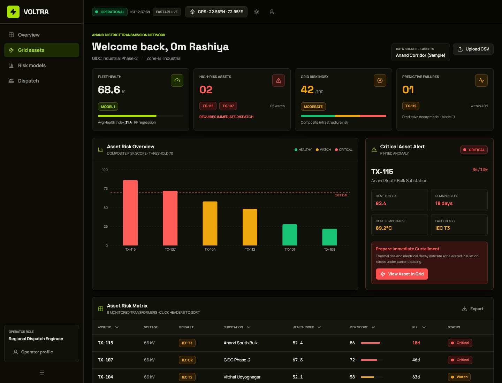

# VOLTRA Grid Insights — Transformer Health and Dispatch Dashboard

> A frontend prototype for exploring transformer condition, composite grid risk and inspection priorities from a sample corridor dataset.

**Source repository:** [rashiyaom/voltra-grid-insights](https://github.com/rashiyaom/voltra-grid-insights) (private implementation)

## Purpose

VOLTRA Grid Insights gives a regional operator one view of an asset fleet: health indicators, high-risk transformers, remaining useful life estimates, model summaries and proposed dispatch priorities. Its sample dashboard is designed to demonstrate how asset risk could be read and acted on, rather than burying it in a flat telemetry table.

This repository is a **frontend-only prototype**. The sample numbers, “FASTAPI LIVE” status label and corridor are part of the demonstration UI; they are not a confirmed connection to a live utility network or a deployed prediction service.

## Screens from the app

Captured from the running interface after the dashboard populated its bundled sample data.

## Operator workflow

1. **Select a corridor or upload a CSV.** The UI identifies the data source and asset count.
2. **Review fleet health.** Summary cards expose average health, critical and watch assets, composite risk and a prediction horizon.
3. **Inspect a specific transformer.** The risk matrix connects an asset ID with voltage, fault class, health, risk and remaining life.
4. **Prioritize attention.** Thresholds and criticality make the inspection queue legible.
5. **Open grid assets or dispatch views.** The operator can move from a fleet-level signal to an asset-level screen.
6. **Change presentation.** A light/dark mode supports different work environments.

## Architecture

~~~mermaid
flowchart LR
  OP[Grid operator] --> UI[React / TanStack dashboard]
  CSV[Sample corridor data or CSV upload] --> PARSE[Client-side parsing and validation]
  PARSE --> MODEL[Prototype health and risk calculations]
  MODEL --> STATE[Frontend application state]
  STATE --> KPI[Health, risk, RUL and fleet KPIs]
  STATE --> CHART[Risk chart and asset matrix]
  STATE --> DISPATCH[Dispatch prioritization view]
  KPI --> OP
  CHART --> OP
  DISPATCH --> OP
~~~

### From source row to operator action

~~~mermaid
sequenceDiagram
  participant O as Operator
  participant U as Dashboard
  participant D as Sample or uploaded data
  participant C as Client-side calculation
  participant V as View
  O->>U: Open corridor or choose CSV
  U->>D: Read asset fields
  D-->>U: Transformer measurements and metadata
  U->>C: Validate and calculate demo indicators
  C-->>U: Health, composite risk and RUL values
  U->>V: Render fleet cards, matrix and alerts
  V-->>O: Present assets for review and dispatch planning
~~~

## Interface modules

- **Overview:** fleet summary, asset-risk chart, critical alert and sortable matrix.
- **Grid assets:** detailed transformer-level view.
- **Risk models:** model and threshold context.
- **Dispatch:** inspection-priority surface.
- **Upload and source badge:** sample or custom dataset selection.
- **Theme and operator context:** visual mode, region and role labels.

## Technical stack

The repository uses React 19, TypeScript, TanStack Start/Router, Vite, Tailwind CSS v4 and charting components. State and calculations are currently browser-side, which makes the dashboard easy to demonstrate but does not provide server persistence, access control or a validated predictive pipeline.

## Data interpretation and limits

Remaining useful life, health score and composite risk are estimates whose quality depends on measurement quality, training data, model calibration and operating context. A utility deployment would need an authenticated backend, traceable telemetry, model versioning, alert thresholds reviewed by power engineers, and a safe dispatch approval process. A frontend screenshot cannot validate a transformer-failure prediction.

The portfolio résumé also records an award for **VOLTRICS**, a related transformer-monitoring project. This repository is named **VOLTRA Grid Insights**; that separate award is included as portfolio context and is not presented as an award for this exact codebase.

## Repository

This public case study keeps the interface evidence and architecture explanation visible while the implementation repository remains private.
